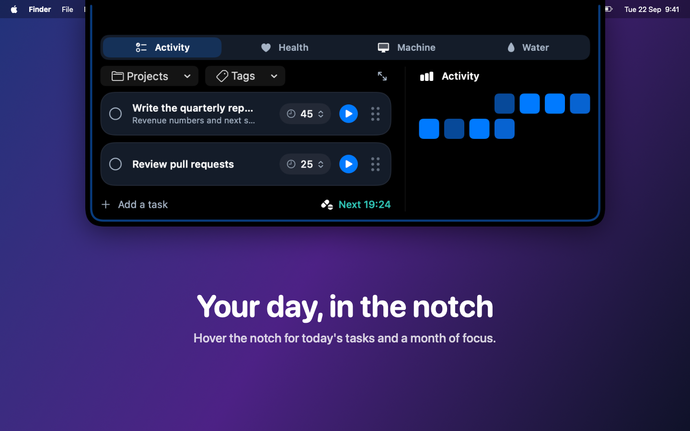
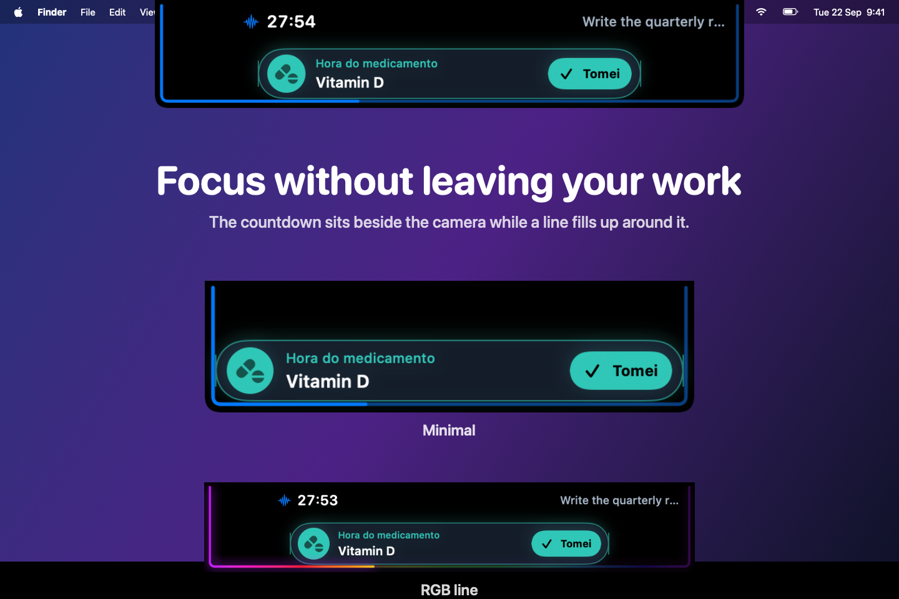
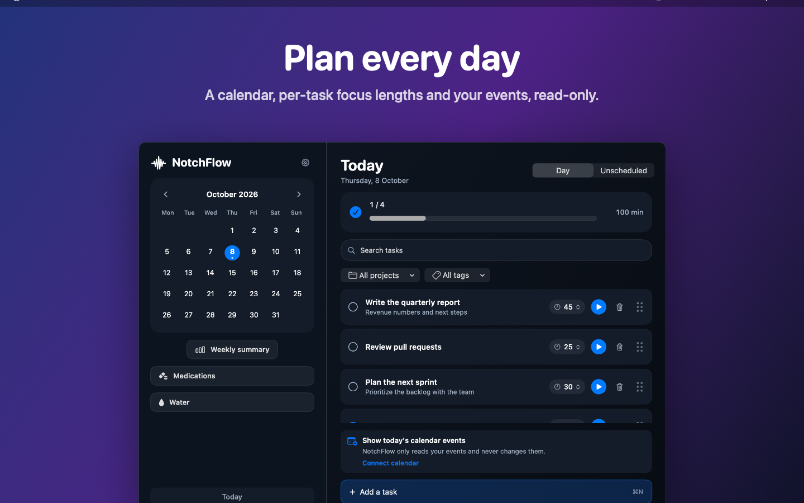
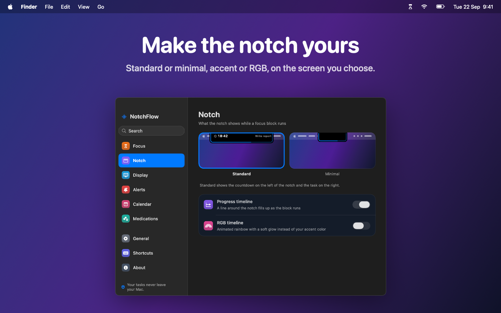
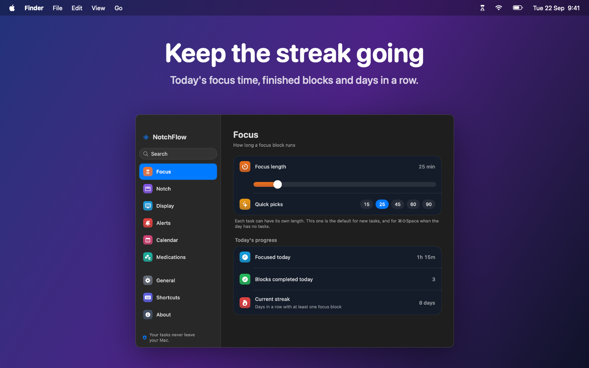

# NotchFlow

**Foco, tarefas e rotina no notch do seu Mac.** Desenvolvido por **Hygor Ferreira**.

Repositório privado: [HygorFerreira/NotchFlow](https://github.com/HygorFerreira/NotchFlow). O acesso ao código no GitHub exige permissão no repositório.

O NotchFlow reúne timer de foco, planejamento, lembretes de medicamentos, acompanhamento de água e uso da máquina em um aplicativo nativo para macOS. Passe o mouse sobre o notch para abrir o painel e acessar sua rotina sem ocupar uma janela permanentemente.

O painel minimalista do notch usa abas centralizadas, cartões grafite e uma grade dos últimos sete dias com intervalos de foco de 40 minutos. A duração das tarefas continua editável ao clicar no tempo; os filtros de projetos e etiquetas ficam no botão no canto superior direito. O modo compacto mostra o progresso abaixo do nome da tarefa.

Feito com **SwiftUI e AppKit**, para **macOS 14 ou superior**, com interface em português do Brasil e inglês. Em telas sem notch, o painel aparece como uma pequena pílula no topo.



## Atualizações recentes

Atualizado em **15 de outubro de 2026**. Versão configurada no projeto: **1.1.0**, build **2**, preparada para teste privado por DMG. As novidades abaixo estão no código em desenvolvimento; não indicam uma nova versão publicada.

- **Anéis, alertas e custos de IA:** Codex e Claude com anéis de sessão e semana (interno, externo ou desativado), seleção do limite principal, porcentagens e tempo até a renovação. Alertas opcionais em 80% e 100%, aviso de renovação e som configurável por serviço. Estimativa do valor consumido da assinatura com preço mensal informado por você, em BRL, USD ou EUR.
- **Consumo de IA:** acompanhamento dos limites das assinaturas do Codex e Claude Code, com login existente, horários de renovação e atualização automática a cada dois minutos. O painel identifica leituras antigas, sessões expiradas e falhas de conexão.
- **Lembretes no notch:** avisos de água e medicamentos em uma pílula com ações rápidas **Bebi** e **Tomei**, além de intervalo de hidratação configurável.
- **Aparência:** Liquid Glass opcional, transparência ajustável, melhorias no calendário e no resumo semanal, com respeito às preferências de acessibilidade do macOS.
- **Foco e tarefas:** pausas preservam frações de segundo; editar uma tarefa mantém o foco já registrado e sua ordenação. Sessões em andamento são registradas ao encerrar normalmente o app.
- **Estabilidade:** validação de títulos, notas e durações, correção da atualização de credenciais do Claude no Chaves e verificação da permissão de leitura do calendário.
- **Qualidade:** testes de regressão do timer e integração contínua para compilações Debug, Release e App Store, além de traduções em português dos lembretes de medicamentos.

O [histórico de alterações](CHANGELOG.md) reúne os detalhes e os marcos anteriores.

## Recursos

| Área | O que você pode fazer |
| --- | --- |
| Foco | Iniciar blocos por tarefa, ajustar a duração, acompanhar a contagem e escolher o estilo da linha de progresso. |
| Tarefas | Planejar pelo calendário, organizar tarefas sem data, adicionar notas, projetos, etiquetas e recorrências. |
| Captura rápida | Registrar uma tarefa de qualquer aplicativo usando `⌘⇧N`. |
| Lembretes | Definir horário de início e alertas para tarefas; cadastrar medicamentos e registrar quando foram tomados. |
| Água | Escolher copo ou garrafa, definir capacidades independentes em ml ou L, acompanhar a meta, o histórico e o gráfico semanal. |
| Máquina | Consultar CPU e memória no painel, com atualização a cada dois segundos enquanto a área está visível. |
| IA | Conectar Codex e Claude Code, consultar porcentagens dos limites da assinatura e horários de renovação, com atualização automática a cada dois minutos. |
| Resumo semanal | Comparar semanas, consultar foco por dia e por tarefa e ajustar a meta semanal. |
| Personalização | Escolher tela, tema claro/escuro/sistema, estilo do notch, Liquid Glass, transparência, alertas, atalhos e abertura ao iniciar sessão. |
| Calendário | Consultar eventos mediante permissão do macOS, sem alterar o calendário. |

Os lembretes de medicamentos aparecem em uma pílula abaixo do notch, com a ação **Tomei**. Em **Água → Suas configurações de água**, ative os lembretes e escolha o intervalo (15 a 180 minutos). Com o app aberto, os avisos de água aparecem das 8h às 22h, pausam ao atingir a meta diária e permitem registrar **Bebi** diretamente na pílula. Avisos simultâneos são apresentados em sequência; cada aviso fica visível por 20 segundos.

As janelas compartilham navegação, campos e botões consistentes. Em **Ajustes → Notch → Aparência**, escolha Claro, Escuro ou Sistema. A tarefa em foco exibe o tempo restante e uma barra de progresso; o calendário distingue hoje, o dia selecionado e os dias planejados. O resumo semanal destaca as métricas e o avanço da meta. Os formulários mantêm suas ações visíveis durante a rolagem, e o painel do notch lembra a última aba escolhida durante a sessão.

Em **Ajustes → Notch**, ative **Liquid Glass** e ajuste a transparência das superfícies. O efeito usa vidro nativo no macOS 26 ou superior e material translúcido nas versões anteriores. A opção **Reduzir Transparência** do macOS tem prioridade; as animações de arraste das tarefas também respeitam **Reduzir Movimento**.

O visual minimalista usa superfícies grafite e cinza, seleções neutras, bordas sutis e azul pontual para ações e progresso. Tarefas, calendário, água, medicamentos, IA e ajustes seguem os mesmos componentes nos temas claro e escuro. Liquid Glass é opcional e começa desativado quando a preferência ainda não foi configurada. Confira as [prévias reais do novo visual em JPEG](output/visual-review/README.md).

## Imagens do aplicativo

Capturas da interface atual em português, com dados de demonstração.

### Foco



### Planejamento de tarefas



### Personalização do notch



### Resumo semanal



## Executar

Você precisa do Xcode completo. Este projeto usa grupos sincronizados de arquivos e requer **Xcode 16.3 ou superior**.

1. Abra `NotchFlow.xcodeproj` no Xcode.
2. Selecione o esquema **NotchFlow** e o destino **My Mac**.
3. Em **Signing & Capabilities**, selecione sua equipe e ajuste o Bundle Identifier conforme sua conta; o projeto pode conter a configuração de assinatura do desenvolvedor.
4. Execute com `⌘R`.

Também é possível compilar e abrir pelo terminal, a partir da pasta do projeto:

```bash
bash scripts/run.sh
```

Para executar a configuração Release:

```bash
bash scripts/run.sh release
```

O aplicativo aparece na barra de menus. Use o ícone de ampulheta para abrir tarefas, água, medicamentos, resumo semanal ou ajustes. O ícone do Dock aparece quando uma janela é aberta.

A janela principal reúne **Tarefas, Medicamentos, Água, Resumo semanal e Consumo de IA** na mesma barra lateral. Trocar de área preserva a busca, os filtros e o estado das telas já visitadas enquanto a janela permanece aberta. Selecionar uma data no calendário abre as tarefas daquele dia. Para trabalhar lado a lado, use **Abrir em nova janela** na barra de ferramentas ou no menu de contexto da área desejada.

## Primeiros passos

1. Abra **Tarefas**, escolha uma data e cadastre sua primeira atividade.
2. Ajuste a duração e use o botão de início para começar o foco.
3. Abra **Água**, escolha seu recipiente e personalize a capacidade e a meta.
4. Cadastre os lembretes desejados em **Medicamentos**.
5. Explore **Ajustes** para configurar tela, atalhos e notificações.

Consulte o [guia de uso](docs/USO.md) para detalhes e solução de problemas.

## Atalhos principais

| Atalho | Ação |
| --- | --- |
| `⌘⇧Espaço` | Iniciar ou parar o foco, inclusive a partir de outro aplicativo. |
| `⌘⇧N` | Abrir a captura rápida global. |
| `⌘N` | Adicionar tarefa na janela de tarefas. |
| `⌘T` | Abrir tarefas pelo menu do aplicativo. |
| `⌘,` | Abrir ajustes. |

Os atalhos globais podem ser desativados nos ajustes. Se outro aplicativo ocupar uma combinação, o status aparece na seção de atalhos.

## Dados e privacidade

Em **IA → Conectar serviços** ou no menu **Consumo de IA…**, ative o interruptor do serviço. O NotchFlow aproveita o login existente: **Entrar…** e **Trocar conta…** encaminham ao Codex ou às instruções de login do Claude Code no terminal. Depois do login, volte ao NotchFlow; ele atualiza as leituras automaticamente ao retornar.

Quando o sandbox bloquear a leitura do Codex, **Permitir acesso…** solicita uma autorização para a pasta de login, já indicada no seletor. No Claude Code, o macOS pode pedir acesso às credenciais no app Chaves. **Opções de conexão** permite escolher uma pasta apenas para perfis personalizados ou instalações com `.credentials.json`. Desative o interruptor para parar o acompanhamento sem sair da conta na ferramenta de origem.

O painel mostra os limites informados pela assinatura, incluindo sessão e semana quando disponíveis. As credenciais são somente lidas para consultar o respectivo serviço. Desativar o interruptor interrompe as consultas e apaga as leituras e permissões de pasta guardadas pelo NotchFlow. Sessões expiradas, falhas de rede e leituras antigas aparecem explicitamente. Os endpoints internos dos serviços podem mudar; conexões baseadas apenas em chaves de API não oferecem esses limites de assinatura.

Em **Consumo de IA…**, expanda **Anéis e renovação**, **Alertas de consumo** ou **Estimativa de custo da assinatura** em cada serviço. O atalho `⌘⇧I` abre essa janela quando o NotchFlow está ativo. Os alertas começam desativados; ao ativá-los, permita as notificações do NotchFlow no macOS. Cada patamar gera um aviso por janela de uso, com estado preservado ao reiniciar; desativar o serviço limpa esse estado. A renovação é identificada na próxima consulta bem-sucedida.

A estimativa usa **preço mensal ÷ 4,35 × porcentagem da cota semanal consumida**. Informe o valor que você realmente paga. O resultado é uma parcela estimada do valor da assinatura, não uma cobrança adicional, uma fatura por tokens ou um custo por projeto. Leituras antigas ou falhas de conexão ocultam a estimativa. Preços e preferências ficam salvos localmente, sem consulta a catálogos externos.

Os registros ficam localmente em `Application Support/NotchFlow/data.json`, no diretório disponibilizado pelo macOS para a execução do app. Em builds com sandbox, esse diretório fica dentro do contêiner do aplicativo. Não há conta, publicidade ou analytics.

Desinstalar apenas o aplicativo não garante a exclusão dos dados. Veja a [política de privacidade](PRIVACY.md) e as instruções de backup no [guia de uso](docs/USO.md).

## Desenvolvimento e distribuição

Para validar as regras de persistência, produtividade, consumo de IA e timer, execute na raiz do repositório:

```bash
bash scripts/test-store.sh
bash scripts/test-productivity.sh
bash scripts/test-ai-usage.sh
bash scripts/test-focus.sh
bash scripts/test-updates.sh
```

Os scripts compilam executáveis Swift independentes. O fluxo de integração contínua em [build.yml](.github/workflows/build.yml) executa essas quatro suítes e compila as configurações Debug, Release e a variante `APPSTORE`.

- [Guia de desenvolvimento](docs/DESENVOLVIMENTO.md): arquitetura, compilação, testes, imagens e distribuição.
- [Como contribuir](CONTRIBUTING.md): organização das alterações e validação.
- [Histórico de alterações](CHANGELOG.md): melhorias atuais e marcos anteriores.
- [Textos para a App Store](appstore/LISTING.md): rascunho em português e inglês.

O código está versionado no repositório privado do GitHub. Um canal público de downloads, URLs de suporte e publicação na App Store ainda precisam ser configurados. Na distribuição direta, o app consulta as releases de `HygorFerreira/NotchFlow` ao iniciar; a verificação manual fica no menu **Buscar atualizações…** ou em **Ajustes > Sobre > Atualizações > Verificar agora**. Releases estáveis com versão superior à instalada oferecem um botão para abrir a página de download. A consulta depende de releases acessíveis pela API pública do GitHub; um repositório privado sem autenticação gera uma mensagem de falha. Na compilação `APPSTORE`, as atualizações são administradas pela loja.

## Licença

Distribuído sob a [licença MIT](LICENSE). Copyright © 2026 Hygor Ferreira.
