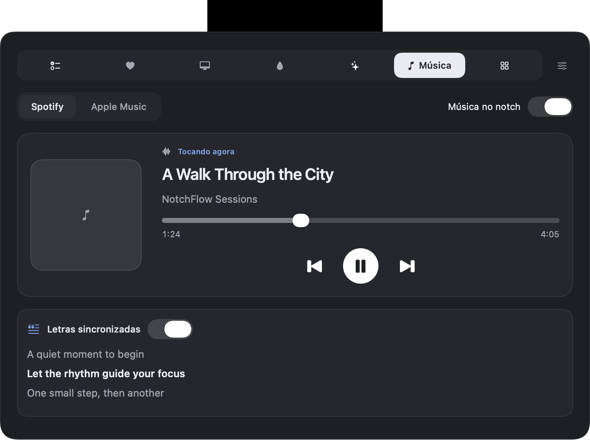
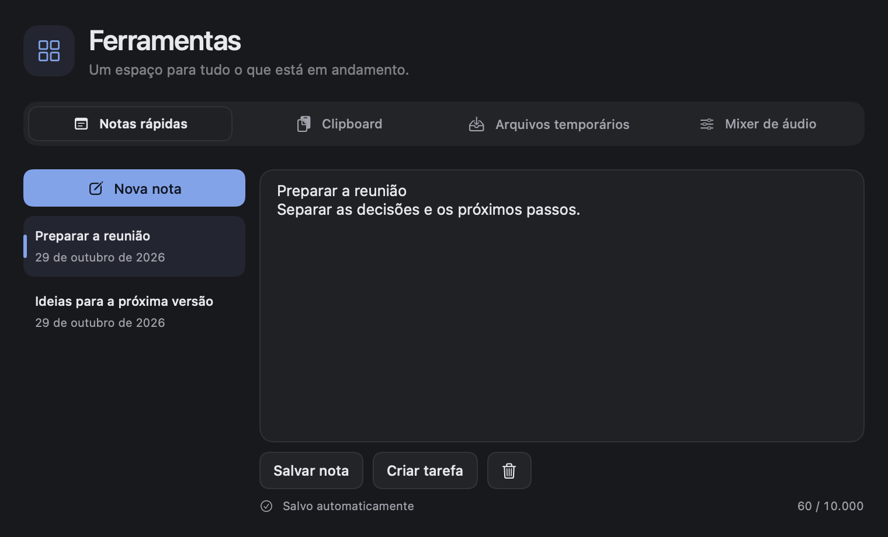

# NotchFlow

**Foco, rotina, música e ferramentas no notch do seu Mac.** Desenvolvido por **Hygor Ferreira**.

Repositório público: [HygorFerreira/NotchFlow](https://github.com/HygorFerreira/NotchFlow).

O NotchFlow reúne timer de foco, planejamento, lembretes de medicamentos, acompanhamento de água, música, mixer de áudio e ferramentas rápidas em um aplicativo nativo para macOS. Passe o mouse sobre o notch para abrir o painel e acessar sua rotina sem ocupar uma janela permanentemente.

O painel minimalista do notch usa abas centralizadas, cartões grafite e uma grade dos últimos sete dias com intervalos de foco de 40 minutos. A duração das tarefas continua editável ao clicar no tempo; os filtros de projetos e etiquetas ficam no botão no canto superior direito. O modo compacto mostra o progresso abaixo do nome da tarefa.

Feito com **SwiftUI e AppKit**, para **macOS 14 ou superior**, com interface em português do Brasil e inglês. Em telas sem notch, o painel aparece como uma pequena pílula no topo.


## Versão 1.3.0

Atualizado em **29 de outubro de 2026**. Versão **1.3.0**, build **4**, para Apple Silicon e Intel.

[**Baixar NotchFlow 1.3.0 para macOS**](https://github.com/HygorFerreira/NotchFlow/releases/download/v1.3.0/NotchFlow-1.3.0.dmg) · [Notas da versão](releases/1.3.0.md)

- **Música e letras:** Spotify ou Apple Music no notch, com capa, controles, posição da faixa e letras sincronizadas opcionais via LRCLIB.
- **Mixer de áudio:** volume e silenciamento por processo, com processamento local. Requer macOS 14.2 ou superior e uma saída compatível.
- **Ferramentas:** notas rápidas com criação de tarefas, histórico opcional de clipboard em memória e cópias de arquivos para arrastar entre aplicativos.
- **Paleta de comandos:** busque ações e tarefas com o atalho global `⌃⌥K`, em português ou inglês.
- **Próximo compromisso:** aviso no notch com antecedência configurável e acesso ao link da reunião.
- **Interface renovada:** navegação com ícones, player com letras e novas telas de ferramentas, mixer e paleta nos temas claro e escuro.

Quem já usa a versão 1.2.0 pode atualizar em **Ajustes → Sobre → Verificar agora**. Em versões anteriores, instale o DMG para receber o atualizador. O pacote direto usa assinatura ad-hoc e não é notarizado; o macOS pode exigir autorização na instalação inicial.

O [histórico de alterações](CHANGELOG.md) reúne os detalhes e os marcos anteriores.

## Recursos

| Área | O que você pode fazer |
| --- | --- |
| Foco | Iniciar blocos por tarefa, ajustar a duração, acompanhar a contagem e escolher o estilo da linha de progresso. |
| Tarefas | Planejar pelo calendário, organizar tarefas sem data, adicionar notas, projetos, etiquetas e recorrências. |
| Captura rápida | Registrar uma tarefa de qualquer aplicativo usando `⌘⇧N`. |
| Lembretes | Definir horário de início e alertas para tarefas; cadastrar medicamentos e registrar quando foram tomados. |
| Água | Escolher copo ou garrafa, definir capacidades independentes em ml ou L, acompanhar a meta, o histórico e o gráfico semanal. |
| Máquina | Consultar CPU e memória no painel, com atualização a cada dois segundos enquanto a área está visível. |
| IA | Conectar Codex e Claude Code, consultar porcentagens dos limites da assinatura e horários de renovação, com atualização automática a cada dois minutos. |
| Resumo semanal | Comparar semanas, consultar foco por dia e por tarefa e ajustar a meta semanal. |
| Personalização | Escolher tela, tema claro/escuro/sistema, estilo do notch, Liquid Glass, transparência, alertas, atalhos e abertura ao iniciar sessão. |
| Calendário | Consultar eventos mediante permissão do macOS, sem alterar o calendário. |
| Música | Conectar Spotify ou Apple Music, controlar reprodução e acompanhar letras sincronizadas. |
| Mixer de áudio | Ajustar volume e silenciar processos de áudio em saídas compatíveis no macOS 14.2 ou superior. |
| Ferramentas | Notas rápidas, clipboard opcional e cópias de arquivos para arrastar entre aplicativos. |
| Paleta | Buscar ações e tarefas pendentes com `⌃⌥K`, de qualquer app. |

### Música no notch

Em **Ajustes → Notch → Módulos do notch**, habilite a aba **Música** se ela ainda não estiver visível. Você também pode abrir **Música…** pelo menu da ampulheta. Abra essa aba, escolha **Spotify** ou **Apple Music** e ative **Música no notch**. Abra o player e autorize a automação quando solicitado pelo macOS. Se a autorização estiver pendente, use **Autorizar acesso**; permissões negadas podem ser alteradas em **Ajustes do Sistema → Privacidade e Segurança → Automação**.

Enquanto uma faixa toca, o notch fechado mostra a capa e um indicador de reprodução. Passe o mouse para ver a faixa, o artista e os controles; clique no título para abrir a aba Música ou no botão de painel para acessar as outras abas. O player completo inclui anterior, reproduzir/pausar, próxima e posição da reprodução. Sem música tocando, o compacto volta ao timer ou ao estado ocioso. Durante o foco, a capa aparece junto da contagem e o nome da tarefa continua visível no modo padrão. O modo mínimo mantém sua preferência de ocultar os textos. Lembretes de água, medicamentos e pausas usam sua própria pílula abaixo da atividade atual.

A integração começa desativada e consulta apenas o player selecionado, a cada dois segundos, sem abrir aplicativos automaticamente. Não exige uma conta adicional e não usa APIs privadas. A capa do Spotify é carregada por HTTPS a partir da URL informada pelo player; a do Apple Music é lida localmente quando disponível. Ative **Letras sincronizadas** para consultar o LRCLIB com título, artista, álbum e duração da faixa. A letra acompanha o progresso e os saltos da reprodução quando há marcações de tempo; letras sem marcações aparecem como texto.

### Mixer de áudio

Abra **ampulheta → Mixer de áudio…** ou **Ferramentas → Mixer de áudio**. Ative o mixer, reproduza áudio em um aplicativo e ajuste o volume de 0 a 100% ou use o botão de silenciar. O macOS solicita autorização para áudio do sistema no primeiro controle de uma fonte.

Requer macOS 14.2 ou superior. Os controles são por processo de áudio: janelas e abas do mesmo aplicativo podem compartilhar uma fonte, e processos auxiliares podem aparecer separados. Esta primeira versão aceita saídas estéreo Float32 com um único stream e sem entrada de microfone no mesmo dispositivo; outras saídas mostram uma mensagem antes de alterar o som.

O áudio é processado localmente, sem gravação. Os ajustes duram durante a sessão e continuam ao fechar o painel. Desativar o mixer, voltar a 100% ou encerrar o NotchFlow restaura a saída original. Ao detectar troca de dispositivo ou taxa de amostragem, o mixer desativa e pede uma nova ativação.

### Paleta e ferramentas

Use **ampulheta → Paleta de comandos…** ou o atalho global **⌃⌥K**. Busque em português ou inglês, navegue com ↑/↓ e pressione Enter para executar. A paleta inclui ações de foco, água, música, IA, ajustes e início de foco para tarefas pendentes. O atalho pode ser desativado em **Ajustes → Atalhos**; conflitos aparecem nessa página.

A aba **Ferramentas** reúne **Notas rápidas**, **Clipboard** e **Arquivos temporários**. Também há entradas diretas no menu da ampulheta e um botão para abrir uma janela maior. Habilite a aba em **Ajustes → Notch → Módulos do notch** se estiver oculta.

- **Notas:** escreva e edite até 10.000 caracteres por nota. O app salva após uma breve pausa na digitação, ao sair da tela e no encerramento normal. **Criar tarefa** gera uma tarefa sem data e mantém a nota original completa; o campo de notas da tarefa conserva seu limite de 500 caracteres. Exclusões podem ser desfeitas enquanto a tela estiver aberta.
- **Clipboard:** começa desativado. Ao ativar, guarda novas cópias de texto (até 100 KB) e imagens PNG (até 5 MB), com busca, copiar novamente e limpeza. São até 30 itens em memória, descartados ao desativar ou encerrar. Cópias marcadas como confidenciais, transitórias ou automáticas pelos aplicativos são ignoradas. O histórico não é um cofre de senhas; pause-o antes de copiar conteúdo sensível.
- **Arquivos:** arraste arquivos sobre o notch ou use **Adicionar arquivos…**. O app guarda até 20 cópias de arquivos comuns, com limite de 200 MB por arquivo, e permite arrastá-las para outro aplicativo. As cópias sobrevivem ao reiniciar. Remover uma cópia a envia para a Lixeira; o original permanece no lugar. Pastas e links simbólicos não são importados.

Em **Ajustes → Calendário**, configure **Próximo compromisso no notch** e a antecedência do aviso. Quando o calendário estiver autorizado, o compromisso aparece abaixo da atividade compacta, com acesso à reunião quando o evento tiver um link compatível. O aviso permanece até cinco minutos após o início, respeitando o fim do evento. Desativar essa opção mantém a consulta de eventos no painel.

Os lembretes de medicamentos aparecem em uma pílula abaixo do notch, com a ação **Tomei**. Em **Água → Suas configurações de água**, ative os lembretes e escolha o intervalo (15 a 180 minutos). Com o app aberto, os avisos de água aparecem das 8h às 22h, pausam ao atingir a meta diária e permitem registrar **Bebi** diretamente na pílula. Avisos simultâneos são apresentados em sequência; cada aviso fica visível por 20 segundos.

As janelas compartilham navegação, campos e botões consistentes. Em **Ajustes → Notch → Aparência**, escolha Claro, Escuro ou Sistema. A tarefa em foco exibe o tempo restante e uma barra de progresso; o calendário distingue hoje, o dia selecionado e os dias planejados. O resumo semanal destaca as métricas e o avanço da meta. Os formulários mantêm suas ações visíveis durante a rolagem, e o painel do notch lembra a última aba escolhida durante a sessão.

Em **Ajustes → Notch**, ative **Liquid Glass** e ajuste a transparência das superfícies. O efeito usa vidro nativo no macOS 26 ou superior e material translúcido nas versões anteriores. A opção **Reduzir Transparência** do macOS tem prioridade; as animações de arraste das tarefas também respeitam **Reduzir Movimento**.

O visual minimalista usa superfícies grafite e cinza, seleções neutras, bordas sutis e azul pontual para ações e progresso. Tarefas, calendário, água, medicamentos, IA e ajustes seguem os mesmos componentes nos temas claro e escuro. Liquid Glass é opcional e começa desativado quando a preferência ainda não foi configurada. Confira as [prévias reais do novo visual em JPEG](output/visual-review/README.md).

## Imagens do aplicativo

Capturas da interface atual em português, com dados de demonstração.

### Foco


### Música e letras sincronizadas



### Notas rápidas



### Planejamento de tarefas


### Personalização do notch


### Resumo semanal


## Executar

Você precisa do Xcode completo. Este projeto usa grupos sincronizados de arquivos e requer **Xcode 16.3 ou superior**.

1. Abra `NotchFlow.xcodeproj` no Xcode.
2. Selecione o esquema **NotchFlow** e o destino **My Mac**.
3. Em **Signing & Capabilities**, selecione sua equipe e ajuste o Bundle Identifier conforme sua conta; o projeto pode conter a configuração de assinatura do desenvolvedor.
4. Execute com `⌘R`.

Também é possível compilar e abrir pelo terminal, a partir da pasta do projeto:

```bash
bash scripts/run.sh
```

Para executar a configuração Release:

```bash
bash scripts/run.sh release
```

O aplicativo aparece na barra de menus. Use o ícone de ampulheta para abrir tarefas, água, medicamentos, resumo semanal, música, ferramentas, mixer de áudio, paleta ou ajustes. O ícone do Dock aparece quando uma janela é aberta.

A janela principal reúne **Tarefas, Medicamentos, Água, Resumo semanal e Consumo de IA** na mesma barra lateral. Trocar de área preserva a busca, os filtros e o estado das telas já visitadas enquanto a janela permanece aberta. Selecionar uma data no calendário abre as tarefas daquele dia. Para trabalhar lado a lado, use **Abrir em nova janela** na barra de ferramentas ou no menu de contexto da área desejada.

## Primeiros passos

Ao abrir o app pela primeira vez, o guia **Primeiros passos** mostra onde encontrar o notch, como criar a primeira tarefa e os atalhos principais. **Criar minha primeira tarefa** abre a captura rápida junto da janela de tarefas. Você pode dispensar o guia e reabri-lo pelo menu da ampulheta ou em **Ajustes → Geral → Primeiros passos**.

1. Abra **Tarefas**, escolha uma data e cadastre sua primeira atividade.
2. Ajuste a duração e use o botão de início para começar o foco.
3. Abra **Água**, escolha seu recipiente e personalize a capacidade e a meta.
4. Cadastre os lembretes desejados em **Medicamentos**.
5. Explore **Ajustes** para configurar tela, atalhos e notificações.

Consulte o [guia de uso](docs/USO.md) para detalhes e solução de problemas.

## Atalhos principais

| Atalho | Ação |
| --- | --- |
| `⌘⇧Espaço` | Iniciar ou parar o foco, inclusive a partir de outro aplicativo. |
| `⌘⇧N` | Abrir a captura rápida global. |
| `⌃⌥K` | Abrir a paleta de comandos global. |
| `⌘⇧I` | Abrir Consumo de IA com o NotchFlow ativo. |
| `⌘N` | Adicionar tarefa na janela de tarefas. |
| `⌘T` | Abrir tarefas pelo menu do aplicativo. |
| `⌘,` | Abrir ajustes. |

Os atalhos globais podem ser desativados nos ajustes. Se outro aplicativo ocupar uma combinação, o status aparece na seção de atalhos.

## Dados e privacidade

Em **IA → Conectar serviços** ou no menu **Consumo de IA…**, ative o interruptor do serviço. O NotchFlow aproveita o login existente: **Entrar…** e **Trocar conta…** encaminham ao Codex ou às instruções de login do Claude Code no terminal. Depois do login, volte ao NotchFlow; ele atualiza as leituras automaticamente ao retornar.

Quando o sandbox bloquear a leitura do Codex, **Permitir acesso…** solicita uma autorização para a pasta de login, já indicada no seletor. No Claude Code, o macOS pode pedir acesso às credenciais no app Chaves. **Opções de conexão** permite escolher uma pasta apenas para perfis personalizados ou instalações com `.credentials.json`. Desative o interruptor para parar o acompanhamento sem sair da conta na ferramenta de origem.

O painel mostra os limites informados pela assinatura, incluindo sessão e semana quando disponíveis. As credenciais são somente lidas para consultar o respectivo serviço. Desativar o interruptor interrompe as consultas e apaga as leituras e permissões de pasta guardadas pelo NotchFlow. Sessões expiradas, falhas de rede e leituras antigas aparecem explicitamente. Os endpoints internos dos serviços podem mudar; conexões baseadas apenas em chaves de API não oferecem esses limites de assinatura.

Em **Consumo de IA…**, expanda **Anéis e renovação**, **Alertas de consumo** ou **Estimativa de custo da assinatura** em cada serviço. O atalho `⌘⇧I` abre essa janela quando o NotchFlow está ativo. Os alertas começam desativados; ao ativá-los, permita as notificações do NotchFlow no macOS. Cada patamar gera um aviso por janela de uso, com estado preservado ao reiniciar; desativar o serviço limpa esse estado. A renovação é identificada na próxima consulta bem-sucedida.

A estimativa usa **preço mensal ÷ 4,35 × porcentagem da cota semanal consumida**. Informe o valor que você realmente paga. O resultado é uma parcela estimada do valor da assinatura, não uma cobrança adicional, uma fatura por tokens ou um custo por projeto. Leituras antigas ou falhas de conexão ocultam a estimativa. Preços e preferências ficam salvos localmente, sem consulta a catálogos externos.

Os registros ficam localmente em `Application Support/NotchFlow/data.json`, no diretório disponibilizado pelo macOS para a execução do app. Em builds com sandbox, esse diretório fica dentro do contêiner do aplicativo. Não há conta, publicidade ou analytics.

Desinstalar apenas o aplicativo não garante a exclusão dos dados. Veja a [política de privacidade](PRIVACY.md) e as instruções de backup no [guia de uso](docs/USO.md).

## Desenvolvimento e distribuição

Para validar as regras de persistência, produtividade, consumo de IA e timer, execute na raiz do repositório:

```bash
bash scripts/test-store.sh
bash scripts/test-productivity.sh
bash scripts/test-ai-usage.sh
bash scripts/test-focus.sh
bash scripts/test-updates.sh
bash scripts/test-keep-awake.sh
bash scripts/test-music.sh
bash scripts/test-audio-mixer.sh
bash scripts/test-tools.sh
```

Os scripts compilam executáveis Swift independentes. O fluxo de integração contínua em [build.yml](.github/workflows/build.yml) executa essas nove suítes e compila as configurações Debug, Release e a variante `APPSTORE`.

- [Guia de desenvolvimento](docs/DESENVOLVIMENTO.md): arquitetura, compilação, testes, imagens e distribuição.
- [Como contribuir](CONTRIBUTING.md): organização das alterações e validação.
- [Histórico de alterações](CHANGELOG.md): melhorias atuais e marcos anteriores.
- [Textos para a App Store](appstore/LISTING.md): rascunho em português e inglês.

O código está disponível no [repositório público do GitHub](https://github.com/HygorFerreira/NotchFlow). Na distribuição direta, o NotchFlow usa Sparkle 2 para consultar um catálogo assinado (`appcast.xml`), baixar um ZIP assinado e instalar a atualização no lugar do aplicativo existente. O DMG fica disponível para a primeira instalação; as atualizações seguintes chegam pelo próprio app. Instale o aplicativo em **Aplicativos** antes de usar o atualizador.

As verificações automáticas ocorrem a cada seis horas. Por padrão, o app baixa as atualizações em segundo plano e instala ao encerrar; você também pode usar **Buscar atualizações…** no menu ou **Ajustes → Sobre → Verificar agora** para atualizar e reiniciar pelo próprio app. Nessa mesma página, é possível desativar as verificações e a instalação automática. Não são enviados dados de rotina nem relatórios de perfil do sistema.

Quem instalou um DMG anterior à versão **1.2.0** precisa substituir o aplicativo uma vez para passar a receber esse mecanismo. A distribuição de teste para amigos pode usar assinatura ad-hoc, sem certificado pago da Apple: os pacotes e o catálogo continuam autenticados com a chave Ed25519 do NotchFlow. Isso não equivale a assinatura Developer ID ou notarização; o macOS pode exigir autorização na instalação inicial. A compilação **NotchFlowAppStore** exclui o Sparkle e recebe atualizações pela loja.

Cada atualização exige uma nova versão, um número de build maior e uma release estável com os arquivos gerados. Commits sozinhos não publicam atualizações. Consulte o [fluxo de releases](docs/ATUALIZACOES.md) para preparar e publicar os arquivos.

## Licença

Distribuído sob a [licença MIT](LICENSE). Copyright © 2026 Hygor Ferreira.
